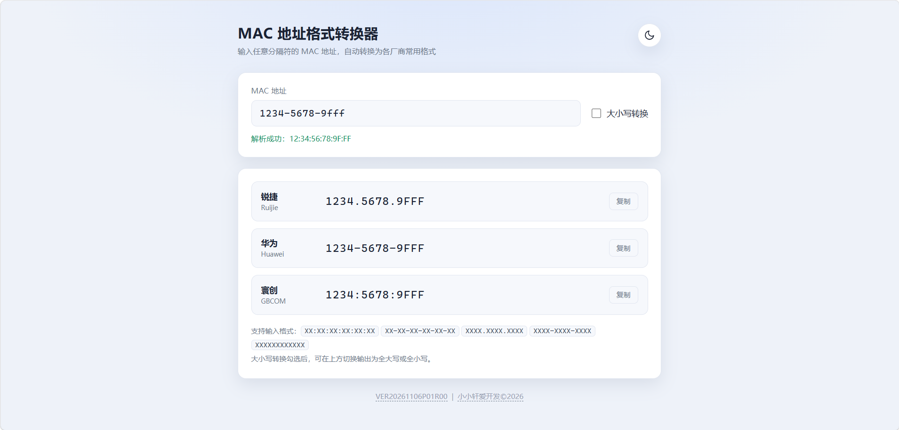
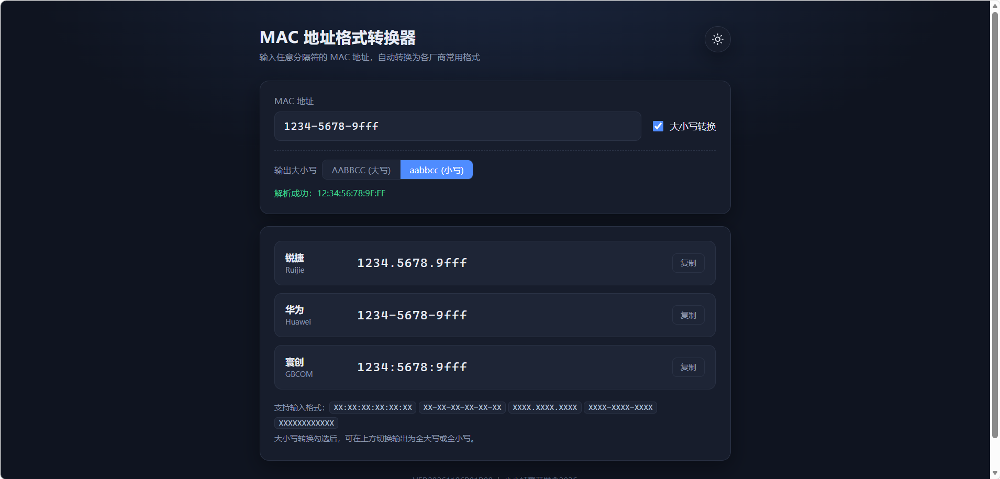
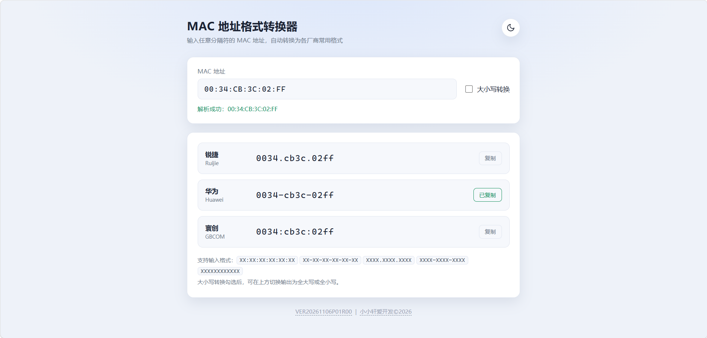

# MFC

一个用于临时转换MAC地址格式的页面，输入MAC地址（支持多种MAC格式）后自动转换为各大品牌的MAC格式且支持大小写转换（如锐捷XXXX.XXXX.XXXX、华为XXXX-XXXX-XXXX、寰创XXXX:XXXX:XXXX）。

## 功能特性

### MAC地址格式转换
- 支持输入多种MAC地址格式
- 支持MAC地址格式快速转换（如锐捷XXXX.XXXX.XXXX、华为XXXX-XXXX-XXXX、寰创XXXX:XXXX:XXXX）
- 支持MAC地址大小写转换

## 快速开始

### 环境要求

- Chromium浏览器92及以上版本

### 启动应用

1.直接打开html文件或网页访问本项目

## 运行截图

